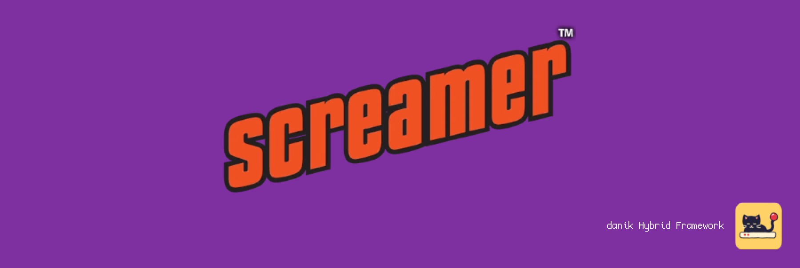
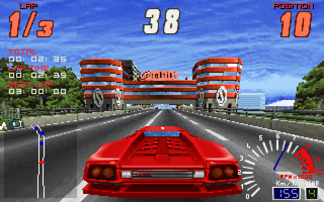

# OpenScreamer for MiSTer

Screamer and Screamer 2 on [MiSTer FPGA](https://github.com/MiSTer-devel/Main_MiSTer/wiki) as a hybrid port.

The game is [OpenScreamer](https://github.com/ItsDanik/openscreamer), a reimplementation of *Screamer* (Graffiti / Virgin Interactive, 1995, MS-DOS) and *Screamer 2* (Graffiti / Virgin Interactive, 1996) written from the original programs. Screamer: the six tracks and their reversed versions, championship, time attack, cone carnage and slalom, replays and records. Screamer 2: the game's own menu and its seven tracks, arcade, championship, time attack and free run, the weather, damage, the cars' set-ups, replays and the CD's music. It runs on the MiSTer's ARM CPU. The OpenScreamer FPGA core provides native 15kHz video (CRT, VGA and HDMI) at 320x200, 320x240, 640x200 or 640x240, 44.1kHz audio, Screamer's FM music chip (an OPL2, as in the sound cards the game was made for) and keyboard and gamepad input, with analog steering, gas and brake, and rumble. The two halves talk through shared DDR3 memory.

> **Beta.** Expect rough edges and please report problems in the issues.
>
> **Disclaimer:** AI is being extensively used to speed up development, but the project is well-maintained and supported.

  
  

## Requirements

- **danik_hybrid_ports**, the launcher: run it **once** from the MiSTer's `Scripts` menu ([The launcher](#the-launcher)). Without it the core says "Game not running".
- **Game data**, which is not included: your own copy of the original DOS *Screamer* (1995), *Screamer 2* (1996), or both. Tested with the retail CD versions. The games are still sold; you need your own copies.
- **Recommended:** a gamepad with two analog sticks and analog triggers, like an Xbox or PlayStation controller. A gamepad without them works but is not recommended. The game can also be played with a keyboard.

## Installation

With `update_all` (Downloader 2.4 or newer, which update_all keeps up to date):

1. Copy [`downloader_danik_hybrid_ports.ini`](https://raw.githubusercontent.com/ItsDanik/Hybrid_MiSTer/main/launcher/downloader_danik_hybrid_ports.ini) to the root of your SD card (`/media/fat`).
2. Run `update_all`. That installs the launcher, **danik_hybrid_ports**, in `Scripts`.
3. Run **danik_hybrid_ports** from the `Scripts` menu, tick the games you want and press *X: Apply*. They are installed, and update_all keeps them up to date.
4. Copy **everything** in each game's folder (the one that holds `DATA` and `GFX`) to its folder in `/media/fat/games/dnk/OpenScreamer/`, with all its folders as they are, and leave nothing out (files the port does not use, such as the `.EXE`s and the sound drivers, do no harm). Nothing has to be unpacked, and upper or lower case does not matter:

   | Game | Folder |
   |---|---|
   | Screamer | `screamer/`, so that there is `.../screamer/DATA/GEN.DAT`, `.../screamer/GFX/GAME.DAT` and so on |
   | Screamer 2 | `screamer2/`, so that there is `.../screamer2/DATA/GEN.DAT`, `.../screamer2/ANIMS/SCENE011.DAT` and so on. Its music is the CD's audio tracks, as files in `screamer2/music/` named `track_02.ogg` .. `track_09.ogg` (`.mp3` or `.wav` do as well); without them Screamer 2 has no music |
5. Load the game from the `Other` menu, e.g. **dnk-Screamer**, or from the `Hybrid Ports` folder if you moved the games there in the launcher.

> [!NOTE]
> The game data can go on a USB drive instead, into the same folders there (`/media/usb0/games/dnk/OpenScreamer/screamer/` and `.../screamer2/`): the game looks for it there first, and then keeps its settings and saved games there as well. Everything else stays on the SD card.

When a game's files are missing, the core says which to copy where; each game checks its files every time it starts and says which are missing or damaged. Screamer's folders from the first release, straight in `OpenScreamer/` (`DATA`, `GFX`, `CONFIG`), keep working. Each game keeps its own OSD settings and button mappings. The core file itself (`_Other/dnk/dnk-OpenScreamer_*.rbf`, or from *Recent*) lists the games that are there to pick from; quitting a game then returns to the list, otherwise to the MiSTer menu. The game's log is in `/media/fat/logs/dnk/OpenScreamer/openscreamer.log`; settings, best times, the championships, saved replays and time-attack ghosts of both games are in `games/dnk/OpenScreamer/saves/`. A new Screamer has three tracks and twelve cars, a new Screamer 2 three tracks and the first league: the rest is won in the championship, as in the originals.

## The launcher

**danik_hybrid_ports** is what turns a menu entry into a running game. Once you've run it from the `Scripts` menu, it starts with the MiSTer, watches which core is loaded, and starts the game whenever a hybrid port's menu entry is loaded. It serves all our hybrid ports at once and updates itself through `update_all`.

Run it from the `Scripts` menu again whenever you want to change something. Its screen has:

- **Launcher**: on or off. Off, the ports' games no longer start (the core says "Game not running"), until you turn it on again.
- **Menu entries**: where the games appear in the MiSTer menu:
  - **Other, as dnk-\<Title\>**: each game in the `Other` menu, e.g. **dnk-Doom** (the default).
  - **Other/Hybrid Ports**: all of them in a *Hybrid Ports* folder in `Other`, without the `dnk-` in front.
  - **Main menu/Hybrid Ports**: a *Hybrid Ports* folder of its own in the main menu, next to `Arcade`, `Console` and `Other`.

  Moving them keeps each game's settings and button mappings. Favourites, recent lists and Zaparoo tags that point at the old place have to be made again.
- **The ports and their games**, a tickbox each. Tick what you want, untick what you don't.

*X: Apply* installs what is ticked and removes what is not, through Downloader, and moves the menu entries if you chose another place. When a port is removed, your game data, saved games and settings stay, and ticking it again brings it back as it was.

## OSD options

| Option | |
|---|---|
| Aspect ratio, Scale, Scandoubler Fx, Stereo Mix | as in other cores |
| FPS Counter | shows the pictures per second in the top left corner |
| HDMI Only | **Yes** if no CRT is connected: resolutions of 640x400 and more are then progressive instead of interlaced, and so is the core's own screen before the game, which moves at 60 pictures a second for a CRT and shows fine lines on HDMI without it. The analog output is switched off while one is shown, so that a 15kHz screen can never get such a signal. OpenScreamer has no such resolution, so nothing changes in the game. Not needed with `forced_scandoubler=1` (VGA monitor); not there with `direct_video=1` |
| CRT Options | **Horizontal Size**: the picture's width **Horizontal Pos**: moves it left or right **Vertical Pos**: moves it up or down **HUD (Top)**: moves the race's labels and clocks 0 to 24 lines down from the top edge (default 0), at 240 rows **HUD (Bottom)**: lifts the race's instruments 0 to 24 lines off the bottom edge (default 0), at 240 rows  For a 15kHz screen: fits the picture to it and keeps the HUD out of the overscan. HDMI is not affected; not there with `forced_scandoubler=1` |
| Resolution | **320x200**: the games' own (default) **320x240**: more of the road and sky **640x200**: twice as sharp across **640x240**: both  For both games. Nothing is stretched: menus sit in the middle of a 240-row screen, the race's instruments at its edges. Changes at once; a change of width in a menu starts the menu again. The 640 modes reach about 35 to 45 pictures a second: use *Lock to 30 FPS* with them |
| Lock to 30 FPS | **Off** (default) **On**: a steady 30 pictures a second, for the 640 modes |
| Rumble | **Off** (default) **On** **Strong**  The controller shakes on wall hits, crashes, contact with other cars, grass, skids and wheelspin |
| Cheats | *Screamer:* **Frozen Countdown**: the race's clock stands still **Mirrored**: picture and steering mirrored **Upside Down**: the picture upside down **Props**: the tracks' other props **Afterburner Difficulty**: AFTERBURNER in the difficulty line **Unlock the Bullet**: the Bullet car **Unlock All Tracks**: all twelve, the reversed ones too  *Screamer 2:* **Unlock All Tracks**: every track **Unlock Fifth Cars**: each team's fifth car **Unlock All Leagues**: every league  The games' cheat words, which need a keyboard. The unlocks are kept with your records or settings, as the typed words are. Each game shows only its own |
| Reset | starts the game again from its beginning, as the USER button does |
| Save Diagnostic Report | the last line: see [If something is wrong](#if-something-is-wrong) |

## Controls

- **Keyboard** (the mouse is not used):

| Key | Action |
|---|---|
| Up / Down | accelerate / brake; in menus: choose a line |
| Left / Right | steer; in menus: change an option, the car, the track |
| Alt / Ctrl (or A / Z) | gear up / down, for cars with manual transmission (Screamer 2: Right Shift / Left Ctrl, or A / Z) |
| C | next view; F1 .. F4 the views one by one |
| M | Screamer: radar zoom (three sizes, off). Screamer 2: the mirror (R too) |
| P | Screamer: the CD player, to choose the song and set the volumes (Screamer 2 has it on its pause screen) |
| Backspace | Screamer: puts the car back onto the road |
| Enter | confirm |
| Esc | back. In a race: Screamer asks whether to leave, Screamer 2 pauses (its pause screen has the CD player and the way out) |

- **Gamepad** (default mapping), the same in both games:

| Button | Action |
|---|---|
| Left stick | steer, analog: the further you push, the sharper the turn; in menus: move |
| D-pad | steer; in menus: move |
| R2 / L2 (the triggers) | accelerate / brake, analog: as hard as you press (needs analog triggers; not in *Define OpenScreamer buttons*) |
| A (Xbox B / PlayStation Circle) | accelerate |
| B (Xbox A / PlayStation Cross) | brake |
| X (Xbox Y / PlayStation Triangle) | Screamer: radar zoom. Screamer 2: the mirror |
| Y (Xbox X / PlayStation Square) | next view |
| L (LB / L1) | gear down |
| R (RB / R1) | gear up |
| Select | back; in a Screamer race: leave (it asks first) |
| Start | confirm; in a race: pause, and again to resume (Screamer: its CD player screen; Screamer 2: its pause screen) |

- **Racing wheel**: a wheel MiSTer knows (Logitech G25, G27, G29 and Driving Force, Fanatec, Thrustmaster and others) steers with the wheel and drives with the pedals, analog: the gas pedal is R2, the brake L2.

Change the buttons in the OSD under *Define OpenScreamer buttons*. *Menu OK* and *Menu Back* there are only needed for a spare button without a game function. While the OSD is open, the game gets no input.

> [!WARNING]
> A button left without a name in *Define OpenScreamer buttons* does not reach the game at all, except L2/R2, L3/R3 and *Menu OK* / *Menu Back*. Name every button there, or leave the definition as it is. To go back to the default buttons, delete `config/inputs/OpenScreamer_*_input_*_v3.map` (each game has its own) on the SD card.

## If something is wrong

If the game stutters, the sound breaks up or something else is wrong, open the OSD while it happens and pick **Save Diagnostic Report**, the last line of the menu. The game keeps running; MiSTer's info box says the report is saved in `games/dnk/diagnostics/` on the SD card. Send that file (`OpenScreamer_<date>_<time>.zip`) with a few words on what went wrong.

The report has the setup (versions, the video and audio lines of `MiSTer.ini`, the OSD settings), how the last 60 seconds went, the game's log and a screenshot. Nothing else: no network settings, addresses, saved games or lists of your files.

## Building

How the port works, how to build it and notes for development: [NOTES.md](NOTES.md).

## Support

If you enjoy this project, you can support my work on [Patreon](https://www.patreon.com/itsdanik).

## Credits

- **Screamer** (1995) and **Screamer 2** (1996) by Graffiti, published by Virgin Interactive: the games this is all for.
- **[OpenScreamer](https://github.com/ItsDanik/openscreamer)**: the reimplementation, by Danik with Claude (Anthropic).
- **[JTOPL](https://github.com/jotego/jtopl)** by Jose Tejada (jotego): the FM chip in the FPGA. **[Nuked OPL3](https://github.com/nukeykt/Nuked-OPL3)** by Nuke.YKT: the same chip in software, for the PC build.
- **[SDL](https://libsdl.org)** by Sam Lantinga and contributors.
- **[stb_vorbis](https://github.com/nothings/stb)** by Sean Barrett and **[dr_mp3 / dr_wav](https://github.com/mackron/dr_libs)** by David Reid: Screamer 2's music files.
- **[MiSTer](https://github.com/MiSTer-devel)** by Sorgelig and the MiSTer-devel contributors: the framework and Template_MiSTer.
- **[MiSTer Frontier](https://github.com/MiSTerOrganize/MiSTer_Frontier)** by MiSTer Organize: thank you for the inspiration. Hybrid cores on the MiSTer, and the way their game is launched (a daemon that watches the loaded core and runs a script from its games folder), were inspired by MiSTer Frontier.

This project and its maintainers are in no way associated with or endorsed by Milestone, Virgin Interactive or any other holder of rights in *Screamer* or *Screamer 2*. It does not include any game data.

## License

The top-level scripts, tools and documentation are licensed under the [GPL-3.0](LICENSE). The components keep their own licenses: the part of the shared framework the game is linked with (`hybrid/hps/`) is GPL-2.0-or-later, the rest of `hybrid/` GPL-3.0 except where its files say otherwise, the game (`openscreamer/`) is GPL-3.0, Nuked OPL3 in it LGPL-2.1-or-later, JTOPL in `hybrid/rtl/jtopl` GPL-3.0, SDL and the SDL drivers in `hybrid/sdl2` are zlib, the FPGA core and the MiSTer framework are GPL-2.0 (`core/LICENSE`, with the core's own sources GPL-2.0-or-later).
