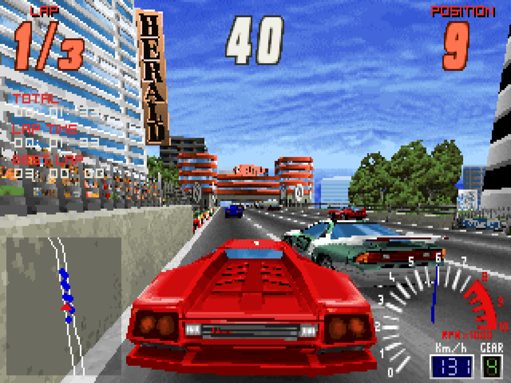
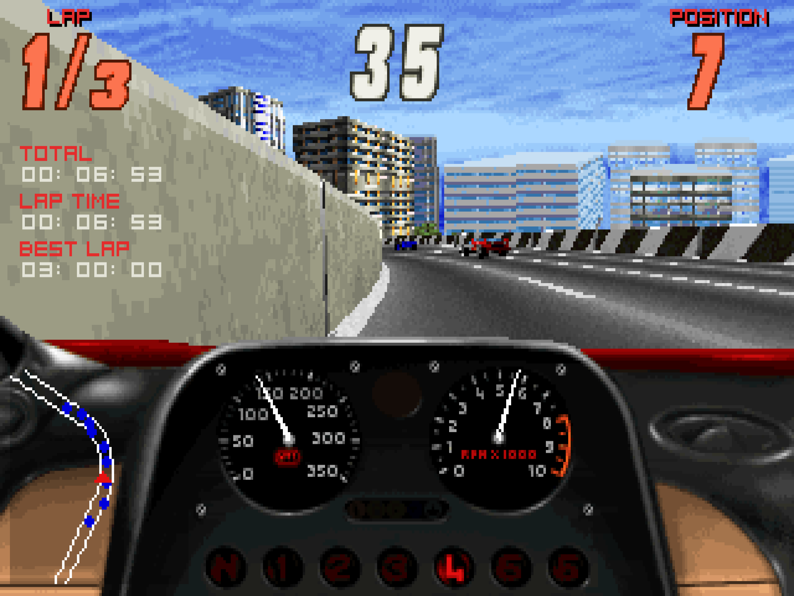
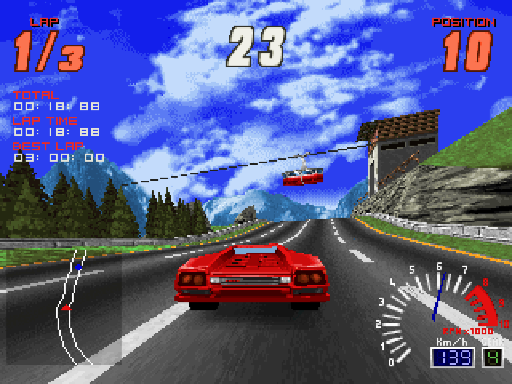
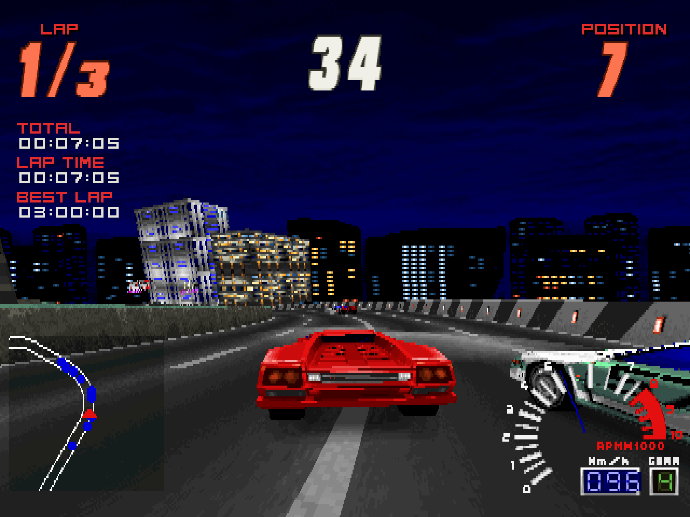
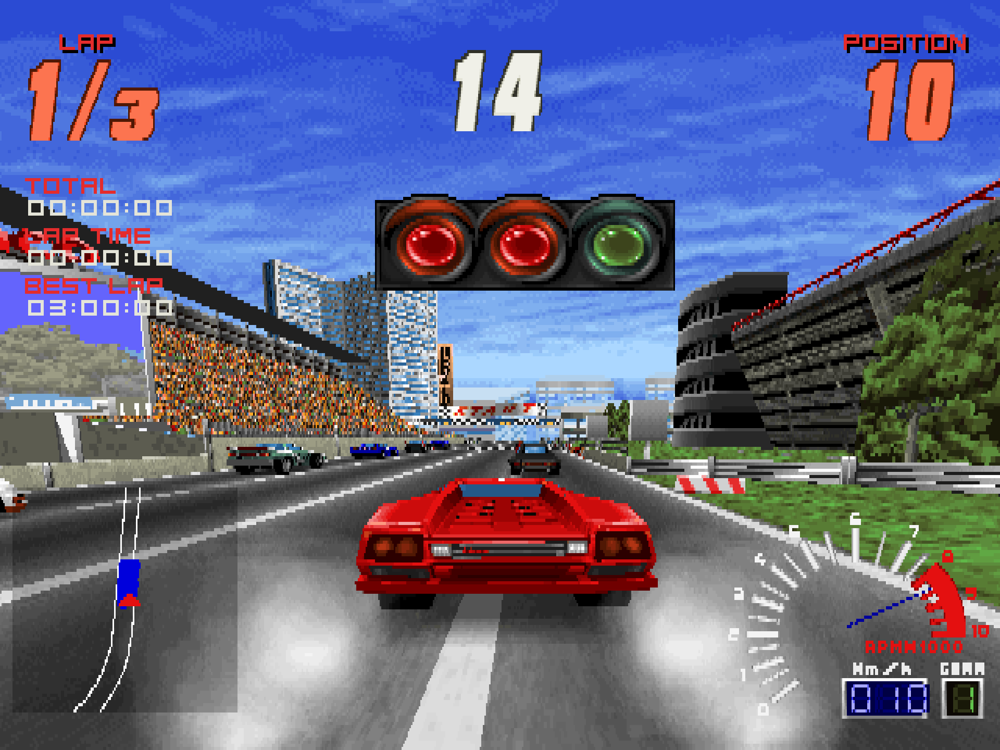
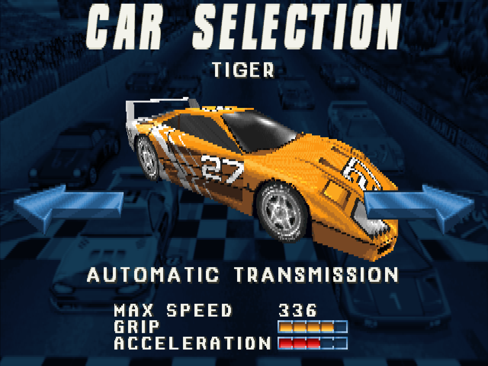

# OpenScreamer for MiSTer

Screamer and Screamer 2 on [MiSTer FPGA](https://github.com/MiSTer-devel/Main_MiSTer/wiki) as a hybrid port.

The game is [OpenScreamer](https://github.com/ItsDanik/openscreamer), a reimplementation of *Screamer* (Graffiti / Virgin Interactive, 1995, MS-DOS) and *Screamer 2* (Graffiti / Virgin Interactive, 1996) written from the original programs. Screamer: the six tracks and their reversed versions, championship, time attack, cone carnage and slalom, replays and records. Screamer 2: the game's own menu and its seven tracks, arcade, championship, time attack and free run, the weather, damage, the cars' set-ups, replays and the CD's music. It runs on the MiSTer's ARM CPU. The OpenScreamer FPGA core provides native 15kHz video (CRT, VGA and HDMI) at 320x200, 320x240, 640x200 or 640x240, 44.1kHz audio, Screamer's FM music chip (an OPL2, as in the sound cards the game was made for) and keyboard and gamepad input, with analog steering, gas and brake, and rumble. The two halves talk through shared DDR3 memory.

| | |
|---|---|
|  |  |
|  |  |
|  |  |

More in [`docs/screenshots/`](docs/screenshots/): Screamer's own pictures in the core's four resolutions, as they are on a 4:3 screen.

> **Beta.** Expect rough edges and please report problems in the issues.

Disclaimer: AI is being used to speed up development of this project.

## Requirements

- **danik_hybrid_ports**, the launcher (`Scripts/danik_hybrid_ports.sh`): run it **once** from the MiSTer's `Scripts` menu. It starts the game whenever its menu entry is loaded, keeps running after a reboot, and serves all our hybrid ports; its screen picks which ports and games to have, and can keep them up to date through `update_all`. It replaces `danik_hybrid_cores`, the launcher before it, and moves ports installed the old way (`games/OpenScreamer/`) into the new folders by itself. Without it the core says "Game not running".
- **Game data**, which is not included: your own copy of the original DOS *Screamer* (1995), *Screamer 2* (1996), or both. Tested with the retail CD versions. The games are still sold; you need your own copies.

## Installation

With `update_all` (Downloader 2.4 or newer, which update_all keeps up to date):

1. Copy [`downloader_danik_hybrid_ports.ini`](https://raw.githubusercontent.com/ItsDanik/Hybrid_MiSTer/main/launcher/downloader_danik_hybrid_ports.ini) to the root of your SD card (`/media/fat`).
2. Run `update_all`. That installs the launcher, **danik_hybrid_ports**, in `Scripts`.
3. Run **danik_hybrid_ports** from the `Scripts` menu, tick the games you want and press *X: Apply*. They are installed, and update_all keeps them up to date.

By hand:

1. Download the newest `OpenScreamer_YYYYMMDD.zip` from [releases](releases/) and extract it to the root of your SD card (`/media/fat`). That gives you:
   - `_Other/dnk-Screamer.mgl` and `_Other/dnk-Screamer 2.mgl`, the games' entries in the `Other` menu
   - `_Other/dnk/dnk-OpenScreamer_YYYYMMDD.rbf`, the FPGA core
   - `games/dnk/OpenScreamer/`, the game binary and its launch script
   - `Scripts/danik_hybrid_ports.sh`, the launcher (from [Hybrid_MiSTer](https://github.com/ItsDanik/Hybrid_MiSTer))
   - `downloader_danik_hybrid_ports.ini`, with which `update_all` keeps the ports up to date from then on
2. Run **danik_hybrid_ports** from the `Scripts` menu, if you have not done so before (see Requirements).

Then the games' files: copy **everything** in each game's folder (the one that holds `DATA` and `GFX`), with all its folders as they are, and leave nothing out. Nothing has to be unpacked, and upper or lower case does not matter. Files the port does not use (the `.EXE`s, the sound drivers) do no harm.

- **Screamer:** to `/media/fat/games/dnk/OpenScreamer/screamer/`, so that there is `.../screamer/DATA/GEN.DAT`, `.../screamer/GFX/GAME.DAT` and so on. If `CONFIG/CONTROLS.CFG` is there, its keyboard keys are used. If you had the first release, your folders straight in the game's folder (`DATA`, `GFX`, `CONFIG`) keep working there.
- **Screamer 2:** to `/media/fat/games/dnk/OpenScreamer/screamer2/`, so that there is `.../screamer2/DATA/GEN.DAT`, `.../screamer2/GFX/GAME1.DAT`, `.../screamer2/ANIMS/SCENE011.DAT` and so on. The game's music is its CD's audio tracks: as files in `screamer2/music/`, named `track_02.ogg` .. `track_09.ogg` (`.mp3` or `.wav` do as well; track 2 is the menu's, 3 to 9 the races'). Without them Screamer 2 has no music.

The games' files can go on a USB drive instead, into the same folders there (`/media/usb0/games/dnk/OpenScreamer/screamer/` and `.../screamer2/`): the games look for them there first, and then keep their settings and saved games there as well (`.../OpenScreamer/saves/`). Everything else stays on the SD card.

Load the game from the `Other` menu: **dnk-Screamer** or **dnk-Screamer 2**. When a game's files are missing, the core says which to copy where; each game checks its files every time it starts and says which are missing or damaged. Each game keeps its own OSD settings and button mappings. The core file itself (`_Other/dnk/dnk-OpenScreamer_*.rbf`, or from *Recent*) lists the games that are there to pick from; quitting a game then returns to the list, otherwise to the MiSTer menu.

The game's log is in `/media/fat/logs/dnk/OpenScreamer/openscreamer.log`. Settings, best times, the championships, saved replays and time-attack ghosts of both games are in `/media/fat/games/dnk/OpenScreamer/saves/` (Screamer's `openscreamer.cfg`, `.records`, `.champ`, `.replays/`, `.ghosts/`; Screamer 2's `openscreamer.s2choice`, `.s2records`, `.s2replays/` and so on). A new Screamer has three tracks and twelve cars, a new Screamer 2 three tracks and the first league: the rest is won in the championship, as in the originals.

## OSD options

| Option | |
|---|---|
| Aspect ratio, Scale, Scandoubler Fx, Stereo Mix | as in other cores |
| FPS Counter | shows the pictures per second in the top left corner |
| HDMI Only | as in the other hybrid ports, for resolutions of 640x400 and more: OpenScreamer has none, so nothing changes here |
| CRT Options | for a 15kHz screen: *Horizontal Size*, *Horizontal Pos* and *Vertical Pos* fit the picture to it. The pixels stay as they are; HDMI is not affected. The size is for the game's picture: the core's own, with its messages, keeps its width. Not there with `forced_scandoubler=1`. *HUD (Top)* and *HUD (Bottom)*: in a race with 240 rows, how many lines the race's labels and clocks at the top and its instruments at the bottom are from the edges of the screen, 0 to 24 (10 by default), so that a CRT's overscan does not hide them; greyed out with 200 rows. They move at once |
| Resolution | both games. **320x200** (default), the games' own; **320x240**: more of the road and sky above and below; **640x200** and **640x240**: twice as sharp across, with the games' high-resolution pictures for menus and instruments. Nothing is stretched: menus sit in the middle of a 240-row screen, the race's instruments at its edges (see *HUD (Top)* / *HUD (Bottom)*). It changes at once, wherever you are; a change of width in a menu starts the menu again. The 640 modes cannot reach 60 pictures a second (about 35 to 45): use *Lock to 30 FPS* with them |
| Lock to 30 FPS | Off (default) / On: a steady 30 pictures a second, for the 640 modes |
| Rumble | **Off** (default) / On / Strong: the controller shakes on wall hits, crashes, contact with other cars, grass, skids and wheelspin |
| Cheats | what the games' cheat words do, which need a keyboard. **Screamer:** *Frozen Countdown* (the race's clock stands still), *Mirrored* (the picture and the steering left-right), *Upside Down* (the picture upside down, no cockpit view), *Props* (the tracks' second or third set of props, from the next race), *Afterburner Difficulty* (AFTERBURNER in the difficulty line); *Unlock the Bullet* and *Unlock All Tracks* (all twelve, the reversed ones too) are kept with your records, as the typed words are. **Screamer 2:** *Unlock All Tracks*, *Unlock Fifth Cars* (each team's fifth car) and *Unlock All Leagues*, kept with the game's settings. Each game shows only its own |

## Controls

- **Keyboard** (the mouse is not used):

| Key | Action |
|---|---|
| Up / Down | accelerate / brake; in menus: choose a line |
| Left / Right | steer; in menus: change an option, the car, the track |
| Alt / Ctrl (or A / Z) | gear up / down, for cars with manual transmission (Screamer 2: Right Shift / Left Ctrl, or A / Z) |
| C | next view; F1 .. F4 the views one by one |
| M | Screamer: radar zoom (three sizes, off). Screamer 2: the mirror (R too) |
| P | Screamer: the CD player, to choose the song and set the volumes (Screamer 2 has it on its pause screen) |
| Backspace | Screamer: puts the car back onto the road |
| Enter | confirm |
| Esc | back. In a race: Screamer asks whether to leave, Screamer 2 pauses (its pause screen has the CD player and the way out) |

  The six driving keys are those of the game's `CONFIG/CONTROLS.CFG` when that file is there. To change one, add a line to `saves/openscreamer.cfg`: `key_accelerate=`, `key_brake=`, `key_left=`, `key_right=`, `key_gear_up=` or `key_gear_down=` with a key's name, such as `key_brake=Space`.

- **Gamepad** (default mapping), the same in both games:

| Button | Action |
|---|---|
| Left stick | steer, analog: the further you push, the sharper the turn; in menus: move |
| D-pad | steer; in menus: move |
| R2 / L2 (the triggers) | accelerate / brake, analog: as hard as you press |
| A (Xbox B / PlayStation Circle) | accelerate |
| B (Xbox A / PlayStation Cross) | brake |
| X (Xbox Y / PlayStation Triangle) | Screamer: radar zoom. Screamer 2: the mirror |
| Y (Xbox X / PlayStation Square) | next view |
| L (LB / L1) | gear down |
| R (RB / R1) | gear up |
| Select | back; in a Screamer race: leave (it asks first) |
| Start | confirm; in a race: pause, and again to resume (Screamer: its CD player screen; Screamer 2: its pause screen) |

The triggers are read from the controller directly, not through MiSTer's button mapping, so they are not in *Define OpenScreamer buttons* and need a controller whose triggers are analog (Xbox, PlayStation and the like). The stick's steering is each game's own for a joystick: Screamer takes the stick as it is, Screamer 2 through its own curve (gentle near the middle, the full lock at the end). Standing on the grid, an automatic car in Screamer only takes first gear with the pedal nearly all the way down, as in the original. *Rumble* in the OSD is for controllers that have it.

- **Racing wheel**: the wheels MiSTer itself knows (Logitech G25, G27, G29, Driving Force, Driving Force Pro and GT; Fanatec ClubSport V2.5, Podium DD1 and DD2; Thrustmaster T300RS, F430 and FGT, and a few adapters) steer with the wheel and drive with the pedals, analog: the gas pedal is R2, the brake L2. Map the wheel's buttons in the OSD as for a gamepad. While a wheel is connected, a gamepad's stick pushed up also counts as a pedal, and the gas pedal moves the menus' lines like the stick up.

In the games' menus the buttons that confirm and go back are the ones of your MiSTer menu, whatever they do in a race: its *Menu OK* / *Menu Back* if you set them in *Define joystick buttons*, else its A / B. A controller never set up in MiSTer confirms and goes back as on its console: Cross / Circle on PlayStation, A / B on Xbox and on Nintendo.

Change the buttons in the OSD under *Define OpenScreamer buttons*. *Menu OK* and *Menu Back* there are only needed for a spare button without a game function. While the OSD is open, the game gets no input.

## Building

Everything builds in Docker on a Linux PC.

```sh
git clone --recursive https://github.com/ItsDanik/openscreamer_MiSTer.git
cd openscreamer_MiSTer
./build.sh              # ARM game binary  -> build/mister/openscreamer
./core/build_core.sh    # FPGA core (Quartus Lite 17.0.2) -> core/output_files/OpenScreamer.rbf
./package.sh            # release zip      -> dist/OpenScreamer_YYYYMMDD.zip
```

The toolchain image (Debian bullseye, glibc 2.31 to match the MiSTer) is built from `hybrid/toolchain/` on first use. The first build also downloads and builds SDL2, SDL2_mixer and SDL2_net.

### Repository layout

| Path | |
|---|---|
| `hybrid/` | submodule: [ItsDanik/Hybrid_MiSTer](https://github.com/ItsDanik/Hybrid_MiSTer), what all our hybrid ports share: the FPGA host module, the ARM side library, SDL2 drivers, the launcher (`launcher/danik_hybrid_ports.sh`), toolchain and conventions. See its README. |
| `core/` | FPGA core, based on [Template_MiSTer](https://github.com/MiSTer-devel/Template_MiSTer): `OpenScreamer.sv` (OSD and button names) around `hybrid/rtl/hybrid_host.sv` |
| `openscreamer/` | submodule: the game, branch `mister` (the same as its `main`), with the MiSTer changes in `port/src/mister.[ch]` and behind `MISTER_HYBRID` |
| `package/` | the games and their menu entries (`games.txt`), and the files shipped next to the binary (`danik_hybrid_launch.sh`, README) |
| `releases/` | release packages |

### Development notes

- `./build.sh host` builds the same game for the PC. It runs against `hybrid/tools/fakecore`, a stand-in for the FPGA core that takes scripted input and saves screenshots and audio:
  ```sh
  gcc -O2 -o build/host/fakecore hybrid/tools/fakecore.c
  build/host/fakecore /tmp/shm script.txt audio.raw &
  cd <data folder> && MISTER_HYBRID_SHM=/tmp/shm <repository>/build/host/openscreamer
  ```
- `MISTER=root@<address> tools/test_on_mister.sh S1` tries the build on a MiSTer next to what is installed there, without installing it: from `/tmp`, with the installed game's folder mirrored there (what the game writes stays in `/tmp`) and its own OSD settings. `S2` for Screamer 2, `list` and `nodata` for the core started by itself and without data, `log` for the game's log, `stop` to remove all of it again. `TEST_ENV="OS_TALL=1 OS_WIDE=1"` fixes the resolution for a test (the OSD's is not followed then).
- `touch /tmp/openscreamer_nolaunch` on the MiSTer keeps the core loaded without starting the game, so you can start a development binary by hand (`MISTER_HYBRID_CORE=OpenScreamer`, and `MISTER_HYBRID_SET=OpenScreamer_S1` or `_S2` for a game). `/tmp/danik_hybrid_ports.log` shows what the launcher daemon did.

## Support

If you enjoy this project, you can support my work on [Patreon](https://www.patreon.com/itsdanik).

## Credits

- **Screamer** (1995) and **Screamer 2** (1996) by Graffiti, published by Virgin Interactive: the games this is all for.
- **[OpenScreamer](https://github.com/ItsDanik/openscreamer)**: the reimplementation, by Danik with Claude (Anthropic).
- **[JTOPL](https://github.com/jotego/jtopl)** by Jose Tejada (jotego): the FM chip in the FPGA. **[Nuked OPL3](https://github.com/nukeykt/Nuked-OPL3)** by Nuke.YKT: the same chip in software, for the PC build.
- **[SDL](https://libsdl.org)** by Sam Lantinga and contributors.
- **[stb_vorbis](https://github.com/nothings/stb)** by Sean Barrett and **[dr_mp3 / dr_wav](https://github.com/mackron/dr_libs)** by David Reid: Screamer 2's music files.
- **[MiSTer](https://github.com/MiSTer-devel)** by Sorgelig and the MiSTer-devel contributors: the framework and Template_MiSTer.
- **[MiSTer Frontier](https://github.com/MiSTerOrganize/MiSTer_Frontier)** by MiSTer Organize: thank you for the inspiration. Hybrid cores on the MiSTer, and the way their game is launched (a daemon that watches the loaded core and runs a script from its games folder), come from MiSTer Frontier. Our launcher is a separate implementation and does not need MiSTer Frontier installed.

This project and its maintainers are in no way associated with or endorsed by Milestone, Virgin Interactive or any other holder of rights in *Screamer* or *Screamer 2*. It does not include any game data.

## License

The top-level scripts, tools and documentation are licensed under the [GPL-3.0](LICENSE). The components keep their own licenses: the shared framework in `hybrid/` is GPL-3.0 except where its files say otherwise, the game (`openscreamer/`) is GPL-3.0, Nuked OPL3 in it LGPL-2.1-or-later, JTOPL in `hybrid/rtl/jtopl` GPL-3.0, SDL and the SDL drivers in `hybrid/sdl2` are zlib, the FPGA core and the MiSTer framework are GPL-2.0 (`core/LICENSE`, with the core's own sources GPL-2.0-or-later).
